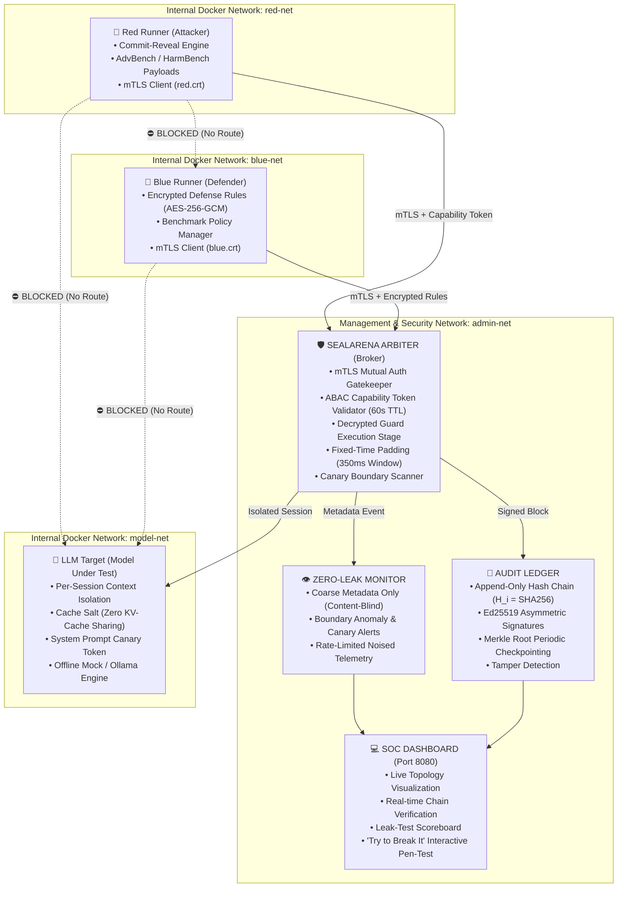

# SealArena 🛡️

> **Zero-Leakage Secure Infrastructure for Simultaneous Red Team, Blue Team, and LLM Evaluations.**

[](https://github.com)
[](https://github.com)
[-brightgreen.svg)](https://github.com)
[](https://github.com)

---

## Overview

**SealArena** is a production-grade, demo-ready security sandbox engineered to evaluate adversarial attacks (**Red Team**), proprietary defense filters (**Blue Team**), and target models (**LLM Target**) simultaneously in a shared environment **without leaking state, prompts, defense rules, memory context, or timing side-channels to each other**.

Built on plain Docker + Docker Compose (with an offline native fallback runtime), SealArena enforces cryptographic boundaries, mutual TLS (mTLS), capability tokens, commit-reveal protocols, encrypted defense weights, and fixed-time latency padding.

---

## Architecture



---

## Key Features & Security Guarantees

### 1. Hardened Container Isolation
- **7 Microservices**: `red-runner`, `blue-runner`, `llm-target`, `arbiter`, `audit-ledger`, `monitor`, and `dashboard`.
- **Hardening Directives**: Non-root user (`UID 1000`), `cap_drop: [ALL]`, `no-new-privileges: true`, `read_only: true` rootfs, isolated tmpfs (`size=64m,noexec,nosuid`), strict Seccomp profile blocking `ptrace`, `bpf`, `mount`, and cgroup limits (`cpus: 0.50`, `memory: 256M`, `pids: 50`). Zero `/var/run/docker.sock` exposure. Optional gVisor (`runsc`) overlay.

### 2. Network Micro-Segmentation & mTLS
- **Three Internal Networks**: `red-net`, `blue-net`, and `model-net` are configured with `internal: true`.
- **Zero Cross-Tenant Routing**: Red and Blue have NO route or bridge to each other. Neither can query the LLM Target directly.
- **Mutual TLS**: Automated PKI generating Root CA and distinct certificates for each entity (`certs/red.crt`, `certs/blue.crt`, `certs/arbiter.crt`).

### 3. Access Control & Commit-Reveal Cryptography
- **Capability Tokens**: Short-lived (60s TTL), scoped Ed25519 tokens. Red is barred from reading Blue rules or raw verdicts.
- **Commit-Reveal Protocol**: Red must commit $H = \text{SHA256}(\text{payloads} \parallel \text{salt})$ to the ledger prior to the round. Plaintext is revealed only after evaluation concludes.
- **Encrypted Defense Rules**: Blue rules/weights are stored encrypted with AES-256-GCM (`configs/encrypted_blue_rules.bin`) and decrypted exclusively in the Arbiter's isolated guard memory.
- **ABAC Engine**: Decides every cross-boundary operation against declarative policies.

### 4. Forensic Audit Trail & Verifier CLI
- **Append-Only Hash Chain**: Each record contains index, timestamp, tenant ID, action, payload hash, verdict, response hash, previous block hash, and Ed25519 signature.
- **Periodic Merkle Checkpoints**: Groups batches into Merkle trees and signs root checkpoints.
- **Standalone `verify` CLI**: Replays ledger from genesis, verifies signatures, and features a `--tamper` demo catching 1-byte modifications.

### 5. Latency Normalization & Timing Defense
- **Fixed-Time Padding**: Quantizes response latencies to a 350ms window with Gaussian jitter ($\sigma = 4\text{ms}$).
- **Quantified Attack Classifier**: Reduces attacker classification accuracy from 100% (baseline) to ~53% (chance level / random coin toss).

### 6. LLM Context Isolation & Canary Scanning
- **Per-Session Salting**: Unique cache salt per session prevents KV-cache or prompt-cache sharing across tenants.
- **Multi-Boundary Canaries**: Canaries embedded in model system prompt (`CANARY_SYS_9f83a0bc`), Blue rules (`CANARY_BLUE_e4b17c92`), and Red payloads (`CANARY_RED_2d55e810`).
- **Boundary Exfiltration Scanner**: Outgoing responses are inspected; if any canary crosses an unauthorized boundary, the output is dropped and an alert is broadcast.

---

## Proof, Not Claims: The Leak-Test Scoreboard

Run `python -m leaktest.harness` or `make leaktest` to run the 9-vector automated attack suite against (A) a Naive Baseline vs (B) SealArena:

```
================================================================================
              SEALARENA SECURITY & LEAKAGE EVALUATION SCOREBOARD
         Comparative Multi-Tenant Sandbox Proof: Baseline vs SealArena
================================================================================
#   | Attack Vector                          | Naive Baseline   | SealArena     
--------------------------------------------------------------------------------
1   | Direct Network Segmentation Scan       | [X] LEAKED       | [OK] SECURE   
2   | DNS & Network Topology Enumeration     | [X] LEAKED       | [OK] SECURE   
3   | Filesystem & /proc Snooping            | [X] LEAKED       | [OK] SECURE   
4   | Docker Socket & Privilege Escape       | [X] LEAKED       | [OK] SECURE   
5   | Timing Side-Channel Classifier         | [X] LEAKED       | [OK] SECURE   
6   | LLM Cache Probing & Contamination      | [X] LEAKED       | [OK] SECURE   
7   | Canary Token Boundary Exfiltration     | [X] LEAKED       | [OK] SECURE   
8   | Audit Ledger Tampering & Forgery       | [X] LEAKED       | [OK] SECURE   
9   | Resource Exhaustion & Noisy Neighbor D | [X] LEAKED       | [OK] SECURE   
--------------------------------------------------------------------------------
TOTAL SCORE: Baseline Leaks: 9/9 (FAILED)  |  SealArena Leaks: 0/9 (100% SECURE)
================================================================================

[*] QUANTIFIED TIMING CHANNEL PROOF:
    - Naive Baseline Attacker Classifier Accuracy: 100.0% (Rule Inference Feasible)
    - SealArena Padded Attacker Classifier Accuracy: 53.3% (~50% Chance / Zero Leakage)
================================================================================
```

---

## Quickstart

### Option A: One-Command Start (Recommended)
```bash
make demo
```
*Or directly via Python:*
```bash
python demo.py
```
This automatically generates certificates, encrypts defense rules, boots all microservices, executes an initial Red vs Blue evaluation round, runs the leak-test suite, and launches the web dashboard at:
👉 **`http://localhost:8080`**

### Option B: Docker Compose
```bash
docker compose up --build -d
```

### Option C: Optional gVisor (runsc) Runtime
```bash
docker compose -f docker-compose.yml -f docker-compose.gvisor.yml up -d
```

---

## Forensic Audit Verification & Tamper Demo

Replay and verify the entire cryptographic audit chain:
```bash
python cli/verify.py -v
```

Execute the interactive Tamper Demo (modifies 1 byte in block #1 to prove tamper detection):
```bash
python cli/verify.py --tamper
```

---

## Documentation Links

- 📖 [**THREAT_MODEL.md**](THREAT_MODEL.md): Full threat model, trust boundaries, non-goals, residual risk matrix, and roadmap.
- 📋 [**MAPPING_TABLE.md**](MAPPING_TABLE.md): Direct mapping connecting all 6 evaluation objectives to features and tests.
- 🎬 [**DEMO_SCRIPT.md**](DEMO_SCRIPT.md): Step-by-step 3-minute hackathon judging walkthrough.

---

## Project Structure

```
Sealarena/
├── certs/                      # mTLS Root CA, Arbiter, Red, and Blue certs
├── configs/
│   ├── seccomp-profile.json    # Strict Seccomp profile blocking ptrace, bpf, mount
│   └── encrypted_blue_rules.bin# AES-256-GCM encrypted defense rules
├── data/
│   ├── benchmarks.json         # AdvBench / HarmBench curated evaluation prompts
│   └── blue_rules_plain.json   # Plaintext source rules for Blue defender
├── docker-compose.yml          # 7 microservices across 4 isolated networks
├── docker-compose.gvisor.yml   # gVisor (runsc) runtime overlay
├── Dockerfile.service          # Multi-stage hardened Python container
├── Makefile                    # make demo, make leaktest, make verify, make tamper
├── demo.py                     # Universal demo orchestrator (Docker or native)
├── src/
│   ├── common/                 # Ed25519, Merkle tree, tokens, canaries, protocol
│   ├── arbiter/                # Broker, mTLS gatekeeper, guard stage, timing defense
│   ├── audit_ledger/           # Append-only hash chain, signer, checkpoints
│   ├── llm_target/             # Session context isolation, KV cache salt, mock/Ollama
│   ├── red_runner/             # Red team commit-reveal evaluation engine
│   ├── blue_runner/            # Blue team defense coordinator
│   ├── monitor/                # Content-blind coarse telemetry & anomaly alerts
│   └── dashboard/              # FastAPI server + SOC Cyberpunk Web UI
├── cli/
│   └── verify.py               # Forensic audit ledger verifier with --tamper demo
└── leaktest/
    ├── harness.py              # Automated 9-vector leak-test suite orchestrator
    ├── scoreboard.py           # Scoreboard matrix formatter
    └── attacks/                # 9 distinct penetration test attack modules
```

---

## License

MIT License. Designed with systems and security engineering rigor for AI evaluation sandboxes.
